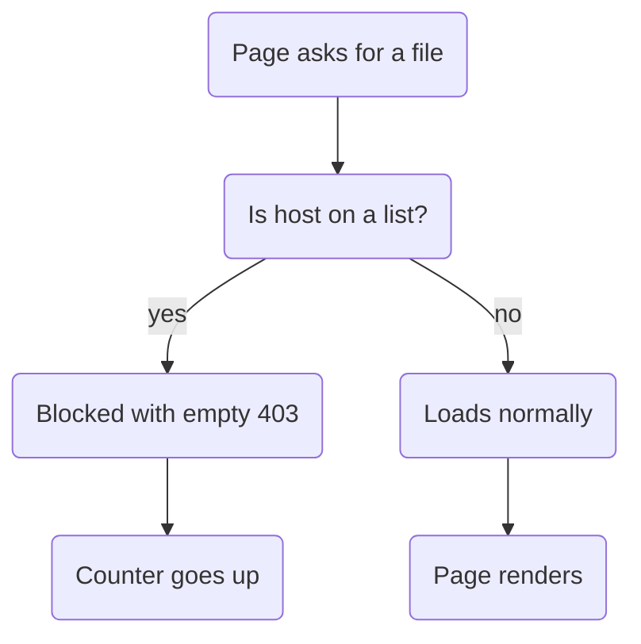
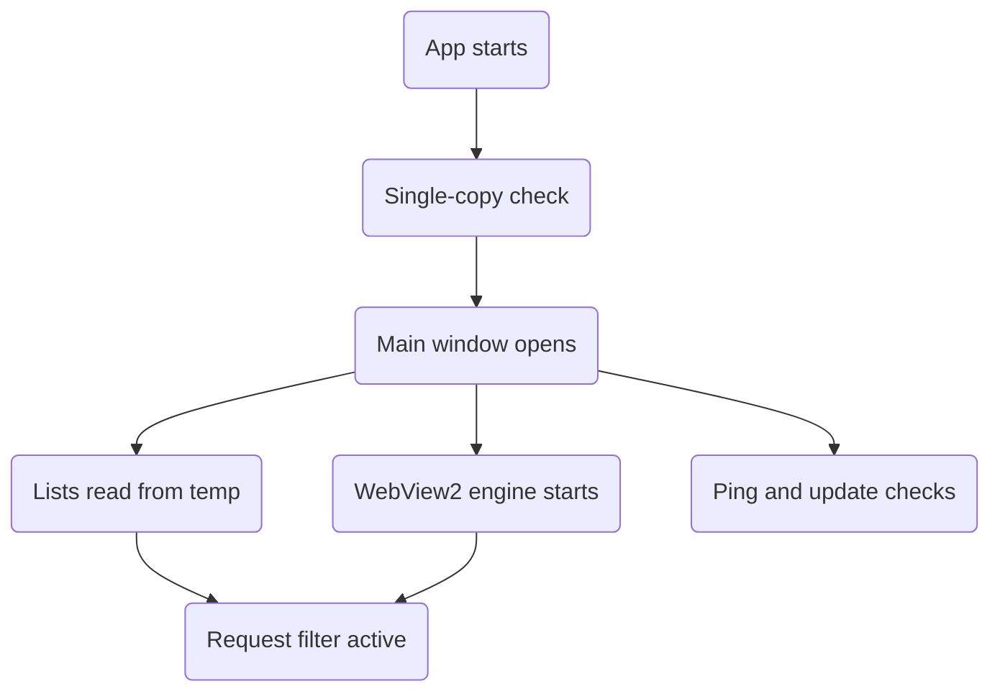

<h1 align="center">Un0</h1>

<p align="center">
  <b>Watch movies. No ads. No noise.</b><br>
  A fast, lightweight Windows browser that filters ads before they ever reach the page.
</p>

<p align="center">
  
  
  
  
</p>

---

## Why Un0

Most browsers load the ad, then hide it. **Un0 never loads it.** Every request the page makes is checked against five Hagezi *pro* blocklists, and anything on the list is cancelled before it leaves the machine — so pages open lighter, play smoother, and use less data.

Built for one job: open the home page, pick something to watch, and get zero interruptions.

- 🟢 **Ad and tracker blocking** on every request, not just the ones you see
- ⚡ **Instant start-up** — blocklists load from a temp-folder cache in milliseconds
- 🎬 **Video-first** — fullscreen mode, 4× volume boost, pop-under and pop-up killing
- 📶 **Connection health** — live ping readout so you know if a stutter is the site or your internet
- 🪶 **Tiny** — one window, no telemetry, no background services

---

## Ad blocking, in three layers

| Layer | What it does |
| :--- | :--- |
| **1. Request filter** | Downloads 5 Hagezi *pro* lists and blocks every matching sub-request. Hosts are checked most-specific-first, so `ads.tracker.example.com` is caught even when only `example.com` is listed. Blocked requests get an empty `403`. |
| **2. Temp-folder cache** | Lists are stored in `%TEMP%\Un0\Blocklists\`. The next start reads them instantly, then refreshes them quietly in the background — fast start, fresh lists. |
| **3. Page cleanup** | An injected script removes ad containers, sticky banners, pop-unders and modal overlays, while leaving upload areas and file pickers untouched. |

**The five lists:**

```text
https://cdn.jsdelivr.net/gh/hagezi/dns-blocklists@latest/adblock/pro.txt
https://cdn.jsdelivr.net/gh/hagezi/dns-blocklists@latest/dnsmasq/pro.txt
https://cdn.jsdelivr.net/gh/hagezi/dns-blocklists@latest/wildcard/pro.txt
https://cdn.jsdelivr.net/gh/hagezi/dns-blocklists@latest/wildcard/pro-onlydomains.txt
https://cdn.jsdelivr.net/gh/hagezi/dns-blocklists@latest/rpz/pro.txt
```

All four formats (adblock, dnsmasq, wildcard, RPZ) are parsed into one domain set, so each list adds coverage instead of duplicating work. **The page you are visiting is never blocked — only its sub-requests.**



---

## Features

| | |
| :--- | :--- |
| **Stabilizing panel** | "Un0 is stabilizing, please wait…" with animated dots while the first page settles |
| **Volume boost** | One-click 4× video volume from the title bar; restores your original level when turned off |
| **Real fullscreen** | Hides the title and status bars, stays on top, `F` toggles it — exiting also pauses the video and clears YouTube/Vimeo iframes |
| **Ping monitor** | Pings `1.1.1.1`, then `8.8.8.8`, every 5 seconds. Green under 100 ms, yellow to 250 ms, orange above, red when offline |
| **Protection counter** | Live count of blocked ads: green, then yellow past 10, red past 20 — resets on sign-out |
| **Update check** | Reads GitHub Releases on start: `✓ Latest` when current, or a dimmed page and download prompt when not |
| **Single instance** | Opening Uno again brings the existing window forward instead of starting a second copy |
| **Clean chrome** | Custom dark title bar, 2 px progress line, one tidy status bar: `Ready | Protected | Ping` |

---

## Install

**Requirements**

- Windows 11 or Windows 10 (64-bit) — *tested on both*
- [.NET 8 Desktop Runtime](https://dotnet.microsoft.com/download/dotnet/8.0)
- [Microsoft Edge WebView2 Runtime](https://developer.microsoft.com/microsoft-edge/webview2/) — already installed on most Windows 10/11 PCs

**Run from source**

```powershell
git clone https://github.com/User07x07/Un0.git
cd Un0
dotnet run
```

**Build a release**

```powershell
dotnet build -c Release
```

---

## Publish from the terminal

The version comes from `version.json` through Nerdbank.GitVersioning, so run these commands **from the repo root** and let git stamp the number — no version flag to type by hand.

**1. Framework-dependent** — small download, needs the .NET 8 Desktop Runtime on the target PC:

```powershell
dotnet publish Uno/Un0.csproj -c Release -r win-x64 --self-contained false -o publish
```

**2. Self-contained single file** — bigger, but runs on a PC with nothing installed:

```powershell
dotnet publish Uno/Un0.csproj -c Release -r win-x64 --self-contained true -p:PublishSingleFile=true -p:IncludeNativeLibrariesForSelfExtract=true -o publish
```

**3. Check it before you ship it** — the exe is in `publish\Un0.exe`; double-click it once and confirm the title bar shows the right version:

```powershell
Start-Process .\publish\Un0.exe
```

**4. Zip it for GitHub Releases** — Un0 looks for updates on GitHub Releases, so the file has to be uploaded there with a tag that matches `version.json`:

```powershell
Compress-Archive -Path publish\* -DestinationPath Un0-v1.11.0-win-x64.zip -Force
```

**5. Upload it** — on GitHub open **Releases → Draft a new release**, tag it `v1.11.0`, attach `Un0-v1.11.0-win-x64.zip`, then publish.

> Bump `version.json` first when you ship a new build, and use the same number in the tag and the zip name. If the tag and `version.json` disagree, the in-app update check will not line up.

---

## Controls

| Key / Button | Action |
| :--- | :--- |
| `F` | Toggle fullscreen |
| `Esc` | Leave fullscreen |
| `◄` | Back |
| `⟳` | Refresh |
| `🏠` | Home |
| `🔊` | Toggle 4× volume boost |
| `↻` | Check for updates |

---

## How it's built

Eleven small services, one job each, wired together by `MainWindow` and talking through events — no god class, no hidden state.



| Service | Responsibility |
| :--- | :--- |
| `WebViewManager` | WebView2 setup, request interception, script injection |
| `HageziBlocklistService` | Fetch, cache, parse the lists; answers `IsBlocked(uri)` |
| `AdBlockerService` | Connects blocklist, counts blocks, supplies cleanup script |
| `ConnectingOverlayService` | The "stabilizing" start-up panel |
| `FullscreenService` | Window state, hidden chrome, stopping video |
| `InternetPingService` | Ping readout and colour |
| `NavigationService` | Back, refresh, home, page events |
| `ProtectionStatusService` | Counter label and thresholds |
| `StatusBarService` | Status text, colours, temporary messages |
| `UpdateService` | Version compare against GitHub Releases (Octokit) |
| `VolumeBoostService` | Volume toggle and restore |

**Stack:** C# · WPF · .NET 8 (`net8.0-windows`) · Microsoft.Web.WebView2 `1.0.4129.50` · Octokit `14.0.0` · Nerdbank.GitVersioning

---

## Known limits

- **Server-side video ads can't be blocked.** When the ad is stitched into the same stream or domain as the movie, blocking it would block the movie too. This is a hard limit of any request-based blocker.
- **The very first launch is slower** — the blocklists download once. Every launch after that reads the cache.
- **The ping needs ICMP.** Some campus and corporate networks block it even when the internet works fine.
- **Lists refresh once per start**, not on a timer.
- **Windows only** — this is a WPF app, so no macOS or Linux build.

---

## Roadmap

### Next up — real volume boost

The volume button currently only **changes colour**: browsers cap a video's volume at `100%`, so the `4×` script is rejected and no sound gets louder. Until this is fixed, treat the boost as cosmetic.

- [ ] **Real amplification** — route the page audio through a Web Audio gain stage (or amplify the system stream) so the level actually rises above 100%
- [ ] **Honest button state** — the icon should only light up when the boost really applied, and fall back to off if it fails
- [ ] **Survive navigation** — the page-side on/off state resets on every new page, so the button and the audio drift apart; re-apply the boost after each load
- [ ] **Reach embedded players** — send the boost into YouTube and Vimeo `iframe` frames, not just the top page
- [ ] **Update the feature table and Controls table** once the boost works for real

### Smaller items

- [ ] Per-site on/off switch
- [ ] Custom user filters
- [ ] Blocklist refresh timer
- [ ] Remember volume level between sessions

---

## Credits

Ad blocking data by **[HaGeZi](https://github.com/hagezi/dns-blocklists)** — the DNS blocklists that make this work. Huge respect for that project.

> **Un0** — because zero ads is the whole point.
